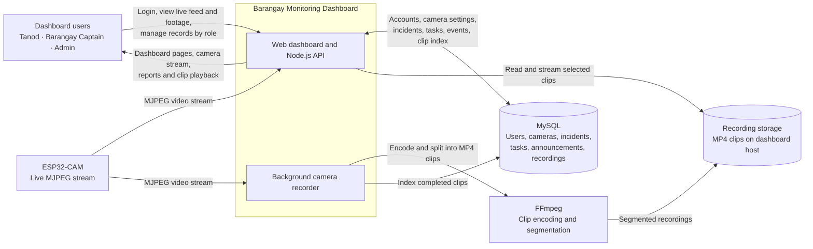

# Barangay Dashboard Context Diagram

The dashboard displays the ESP32-CAM stream directly. The background recorder reads that stream independently, creates segmented MP4 files, and indexes completed clips so signed-in users can find and preview them under **Past Footage**.
